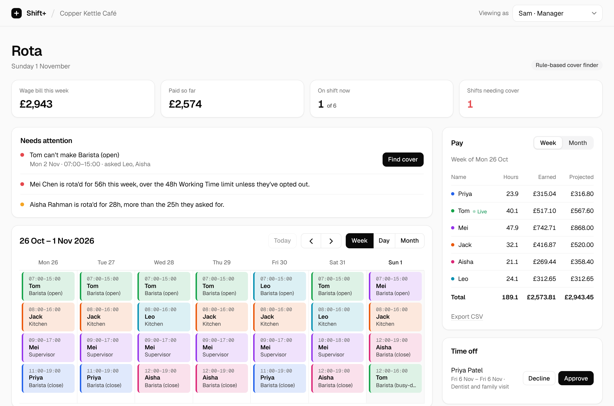
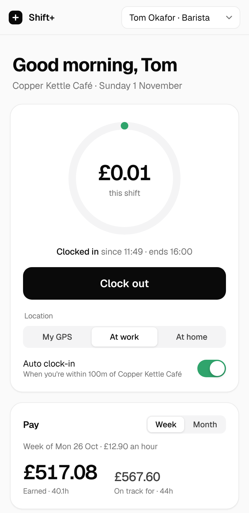
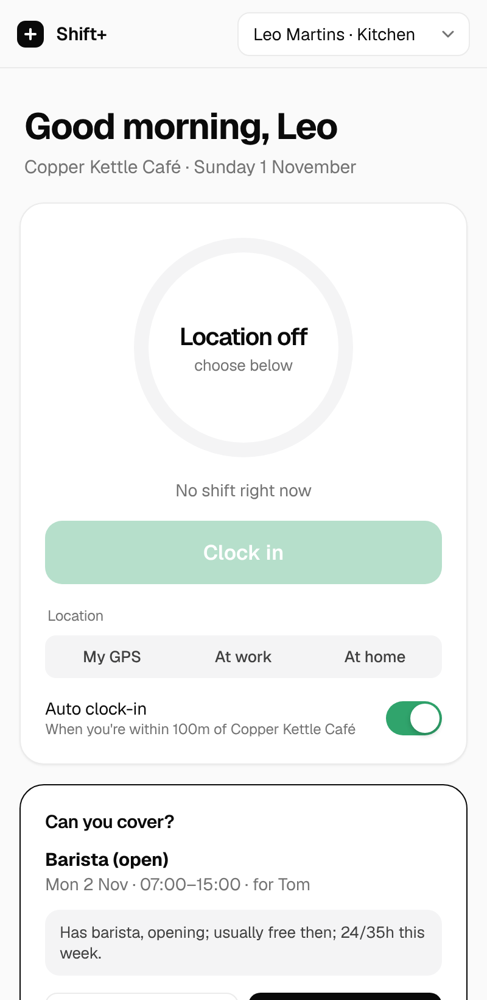
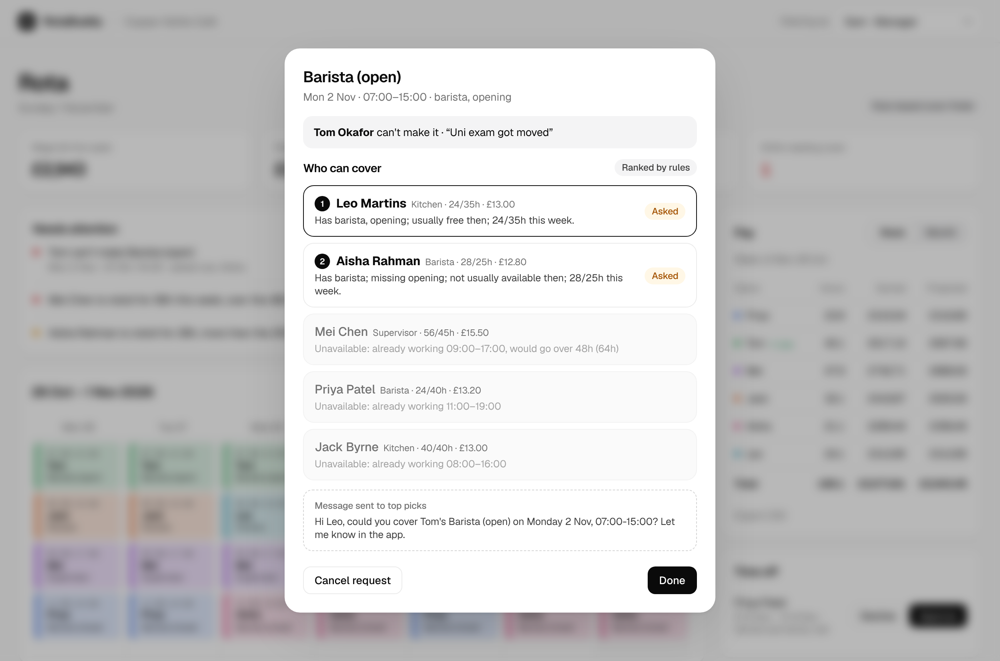

# RotaBuddy

**Simple rotas, proximity clock-in, live pay and an AI shift-cover finder for small businesses.**

Built in one day at the DevDay Exchange Community Hackathon, London, 1 November 2026.

Small cafés, shops and salons run their rotas on WhatsApp groups and spreadsheets. When someone can't make a shift, the owner spends the morning texting people who are already working, on holiday or about to go over their hours. RotaBuddy keeps the rota, clocks people in when they actually arrive, adds up pay as they go, and when a shift is dropped it works out who can really cover it and asks them.



## The core journey

1. **The manager** builds the week on a calendar: drag to add a shift, drag to move it, click to reassign.
2. **A worker arrives at work.** The phone view sees they're within 100 m of the site and clocks them in automatically. If they're further away, clock-in is refused and the app says how far they are.
3. **Pay adds up live:** this shift, this week and this month, with what they'll earn if they work their rota.
4. **The worker taps "Can't make it"** on a future shift. RotaBuddy finds everyone who could cover it: no clashing shift, not on time off, wouldn't break 48 hours. It ranks them with AI on skills, usual availability and hours left, writes a reason for each, and asks the top three.
5. **A colleague taps "Yes, I'll cover".** The calendar, both people's rotas and the pay projections update for everyone.

| Worker: proximity clock-in | Worker: cover request | Manager: AI-ranked cover |
|---|---|---|
|  |  |  |

### Also included

- **Time off requests.** Approving one automatically opens cover requests for any shifts it clashes with.
- **Hours warnings.** The app flags anyone rota'd over the 48-hour UK Working Time limit, or over the hours they said they want.
- **Week/month pay table and CSV export** for the accountant.
- **Late clock-ins** are logged with minutes late.
- **Two-window demo mode.** Pick who you are from the "Viewing as" menu, and the views stay in sync every 4 seconds.

## Run it

You need Node.js 22.9 or later.

```bash
git clone https://github.com/rohansharmacode/Devdayopenai.git
cd Devdayopenai
npm install
cp .env.example .env     # optional: add OPENAI_API_KEY for AI ranking
npm start                # http://localhost:3000
```

- Open two windows: http://localhost:3000/?as=manager and http://localhost:3000/?as=s2 (Tom). Staff ids are s1 to s6, or use the "Viewing as" menu.
- In Tom's window, tap **Simulate: at home**, then **Simulate: at work**. He clocks in automatically. **Use my GPS** uses your real location; the site is a fixed demo point in Shoreditch.
- Tap **Can't make it** on Tom's Monday shift, then switch a window to **Leo Martins** and accept.
- `npm run reset` (or **Reset demo data** in the manager view) re-seeds the data for the current week.

**No API key?** Everything still works. Cover ranking falls back to transparent rules and the UI says "Ranked by rules". With a key, the badge reads "Ranked by AI".

| Variable | Default | Purpose |
|---|---|---|
| `OPENAI_API_KEY` | none | Enables AI ranking of cover candidates |
| `OPENAI_MODEL` | `gpt-6-astra` | Model used for ranking |
| `PORT` | `3000` | HTTP port |
| `DB_FILE` | `data/db.json` | Where data is stored |

### Tests

```bash
npm test
```

There are 18 tests covering distance, clock-in rules, pay maths, CSV, 48-hour warnings, cover eligibility, permissions, the full drop-rank-accept journey (with a fake OpenAI endpoint), time off opening cover requests, and the AI fallback paths.

## How the AI is used

`src/ai.js` calls the OpenAI **Responses API** with **Structured Outputs** (a strict JSON schema), so the result is always `{ ranked: [{ staffId, reason }], message }`.

- **Hard rules run first, in code.** These are clashes, time off and the 48-hour limit, and the model only ever sees people who are allowed to work. It can't put someone into an illegal shift.
- **The model does the judgement call**: trading off skills, availability, hours and cost, explaining it in a sentence, and drafting the message to the top pick.
- **Model output is validated.** Unknown IDs are dropped, and anyone the model skipped is appended in rule order.
- **Data minimisation.** The model gets first names and work facts only, never surnames, contact details or locations.
- **There's a 15-second timeout**, with a rule-based fallback and a visible note when it's used.

## How Codex helped

The app was built in Claude Code. Codex did the final pass. The concrete result is below.

<!-- CODEX-EXAMPLE: fill in after running the steps in docs/codex-final-steps.md -->
_To be filled in with the Codex review findings, the fix commit and the feature Codex added._

## Privacy and safety

- **Location.** The browser's coordinates are sent once per check, used to work out the distance, and thrown away. Only the distance in metres is stored.
- **Demo data.** All people and the café are fictional. No real personal data is in the repo.
- **Secrets.** Keys live in `.env`, which is git-ignored.
- **Not production auth.** The "Viewing as" menu is a demo switch. A real deployment needs proper accounts, with workers only able to act as themselves.

## Project layout

```
src/time.js    date helpers (UK weeks start Monday)
src/seed.js    fictional café, 6 staff, 2 weeks of shifts generated around today
src/rota.js    clock-in, pay, hour warnings, cover candidates (pure functions)
src/ai.js      OpenAI Responses API ranking with rule fallback
src/app.js     Express API
public/        plain HTML/CSS/JS front end (FullCalendar, Geist font)
test/          node:test suites
```

## What's next

- Real accounts, plus SMS or WhatsApp notifications for cover asks.
- A shift-swap marketplace between staff.
- AI-drafted next-week rota from demand and last week's patterns.
- Holiday accrual, and a minimum-wage check against current UK rates.
- A Postgres store for more than one site.

## Credits

- [Express](https://expressjs.com/) (MIT) for the HTTP server.
- [FullCalendar](https://fullcalendar.io/) 6 (MIT) for the calendar views, served from `node_modules`.
- [Geist](https://vercel.com/font) and Geist Mono by Vercel (SIL Open Font License) for type. The visual style follows Vercel's Geist design system (neutral greys, black primary buttons), with Apple-style touches: a translucent header, segmented controls, sheets, switches and a progress ring. It was written from scratch in plain CSS; no template code was copied.
- The OpenAI Responses API powers cover ranking.
- Built with Claude Code (Anthropic) and OpenAI Codex during the hackathon. No templates or pre-existing project code were used.
- The idea was inspired by enterprise workforce tools such as Rotageek, simplified for very small teams. RotaBuddy has no affiliation with them and uses none of their code or assets.

## Licence

MIT, see [LICENSE](LICENSE).
